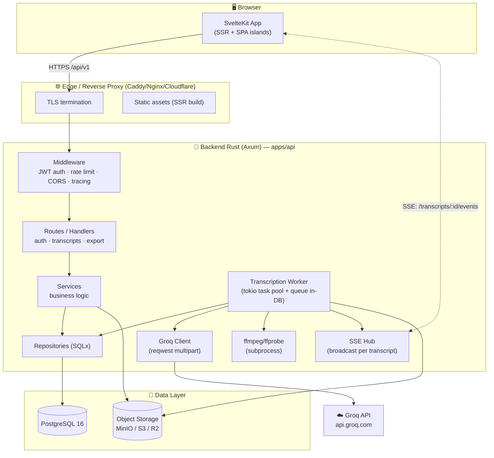
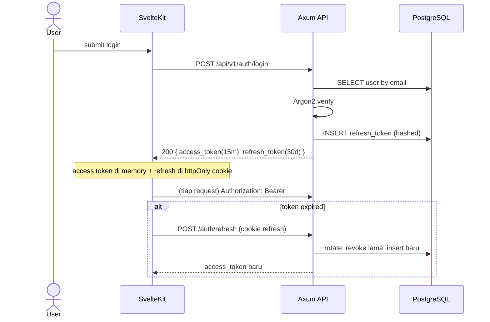
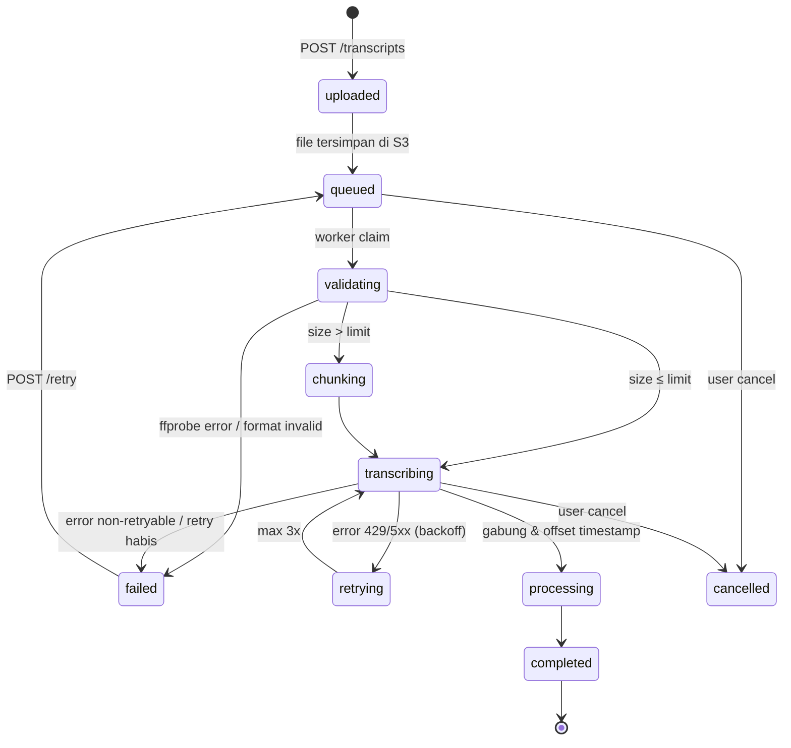
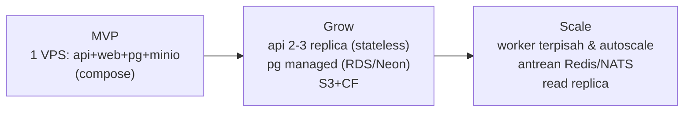

# 02 — System Architecture

## 1. Diagram High-Level



**Prinsip:** *modular monolith* — satu deployable backend, batas modul jelas di level crate/module, sehingga bisa diekstrak jadi service terpisah kalau nanti perlu (lihat [ADR-005](adr/005-modular-monolith.md)).

## 2. Komponen & Tanggung Jawab

### 2.1 Edge / Reverse Proxy
- TLS, gzip/brotli, serve static build SvelteKit (atau di belakang adapter-node).
- Path routing: `/api/*` → backend Rust; sisanya → frontend.
- Upload body limit (mis. 200 MB) sebelum masuk backend.

### 2.2 Backend Rust (`apps/api`)
| Modul | Tanggung jawab |
|---|---|
| `routes/` | HTTP handler, parsing/validasi request, mapping ke response. Tanpa business logic. |
| `services/` | Orkestrasi: `TranscriptService`, `AuthService`, `ExportService`. Unit of work per operasi. |
| `repositories/` | Query SQL via SQLx (compile-time checked). Satu repo per aggregate. |
| `domain/` | Entity + enum status + **state machine** job + invarian. Murni, tanpa I/O. |
| `workers/` | Consumer antrean transkripsi: validasi → (chunk) → panggil Groq → simpan segments → publish SSE. |
| `infra/` | Klien eksternal: `GroqClient`, `ObjectStore`, `SseHub`, ffmpeg wrapper. |
| `config.rs` | Semua dari env (`FIGment`/`serde`), fail-fast saat start. |

### 2.3 Database (PostgreSQL)
- Source of truth untuk user, transcript, segments, token, audit.
- **Antrean job berbasis DB**: row `transcripts` dengan `status='queued'` diambil worker dengan `SELECT ... FOR UPDATE SKIP LOCKED` → tidak butuh Redis/RabbitMQ di fase awal (lihat §5).

### 2.4 Object Storage
- Menyimpan file audio asli (private bucket) — DB hanya menyimpan `storage_key`.
- Lifecycle: hapus otomatis setelah `RETENTION_DAYS` (MinIO ILM / S3 lifecycle rule).
- Backend membuat **pre-signed URL** untuk streaming audio ke player frontend (jangka pendek, mis. 15 menit).

### 2.5 Frontend (SvelteKit)
- SSR untuk halaman publik (landing/login), client-side untuk app (dashboard, editor).
- Konsumsi REST + SSE; tanpa state server global (state = server backend).

## 3. Alur Data End-to-End

### 3.1 Sequence: Upload → Transkripsi → Selesai

```mermaid
sequenceDiagram
    actor U as User
    participant W as SvelteKit
    participant A as Axum API
    participant S3 as Object Storage
    participant DB as PostgreSQL
    participant K as Worker (tokio)
    participant G as Groq API

    U->>W: Drag & drop audio
    W->>A: POST /api/v1/transcripts (multipart)
    A->>A: validasi tipe/ukuran (magic bytes)
    A->>S3: PutObject (streaming)
    A->>DB: INSERT transcripts (status=uploaded)
    A-->>W: 202 { id, status: "queued" }
    Note over K: worker poll antrean (FOR UPDATE SKIP LOCKED)
    K->>DB: claim job → status=processing
    K->>S3: GetObject (stream)
    K->>K: ffprobe → durasi; >25MB? → chunk via ffmpeg
    loop per chunk
        K->>G: POST /audio/transcriptions (multipart)
        G-->>K: verbose_json (segments)
        K->>DB: UPDATE progress; INSERT segments (offset digeser)
        K-->>W: SSE event: progress
    end
    K->>DB: status=completed, gabung segment
    K-->>W: SSE event: completed
    W->>A: GET /transcripts/:id → render editor
```

### 3.2 Sequence: Auth (login + refresh)



## 4. State Machine Job Transkripsi



Invarian (dijaga di `domain/`):
- Transisi hanya via jalur yang diizinkan; transisi lain → error `InvalidStateTransition`.
- `progress` monoton naik; `completed_at` hanya terisi di `completed`.
- `cancelled` hanya bisa dari status aktif (`queued`/`validating`/`chunking`/`transcribing`).

## 5. Desain Antrean Job (DB-based)

**Kenapa tidak Redis/SQS dulu?** Satu dependency lebih sedikit, atomisitas job+status dalam transaksi DB, cukup untuk throughput fase awal (target: ratusan job/jam). Trade-off: polling interval menambah latensi ±2–5 detik — mitigasi: `LISTEN/NOTIFY` PostgreSQL untuk wake worker instan (roadmap v1.1).

```sql
-- Worker claim (satu query atomik)
UPDATE transcripts SET status='validating', updated_at=now()
WHERE id = (
  SELECT id FROM transcripts
  WHERE status='queued'
  ORDER BY created_at
  FOR UPDATE SKIP LOCKED LIMIT 1
)
RETURNING id, storage_key;
```

Konkurensi worker: `N` tokio task (default 4), configurable `WORKER_CONCURRENCY`. Cancellation: worker cek `cancel_requested` flag tiap antara chunk.

## 6. Realtime Progress (SSE)

- `GET /api/v1/transcripts/:id/events` → `text/event-stream`.
- `SseHub`: `DashMap<TranscriptId, Vec<mpsc::Sender>>`; worker publish event → hub fan-out.
- Event: `{"type":"progress","data":{"status":"transcribing","progress":42,"message":"chunk 2/5"}}`.
- Heartbeat tiap 15 detik (comment frame) agar proxy tidak memutus.
- Fallback: polling `GET /transcripts/:id` tiap 3 detik bila SSE diblokir proxy.

## 7. Strategi Keandalan

| Kegagalan | Penanganan |
|---|---|
| Groq 429 / 5xx | Retry exponential backoff + jitter (max 3), hormati `Retry-After` |
| Worker crash saat job | Job stuck >stale-timeout (10 mnt) diambil ulang (status di-reset oleh reaper task) |
| Upload putus | Client chunked upload / presigned multipart (v2; MVP: batas ukuran + retry upload dari awal) |
| DB down | Health check gagal → readiness probe → proxy stop routing; request 503 |
| File korup | ffprobe gagal → status `failed` dengan pesan jelas |

## 8. Scaling Path



- Backend **stateless** (JWT + DB + S3) → horizontal scale hanya dengan menambah replica.
- Pemisahan `api` vs `worker` di binary yang sama via flag `--role api|worker|all` — di prod besar, jalankan keduanya terpisah.

## 9. Keputusan Penting (ringkas → ADR lengkap)

| Keputusan | Pilihan | Alasan |
|---|---|---|
| Web framework | Axum | Ekosistem tokio, middleware tower, typing kuat, komunitas besar |
| ORM | SQLx | Compile-time checked SQL tanpa ORM magic |
| Job queue | DB-based | Simpel & transaksional; upgrade path jelas |
| Realtime | SSE | One-way, murah, auto-reconnect bawaan browser; WS hanya perlu di v2 (streaming) |
| Audio processing | ffmpeg subprocess | De-facto standard; hindari rewrite Rust binding |
