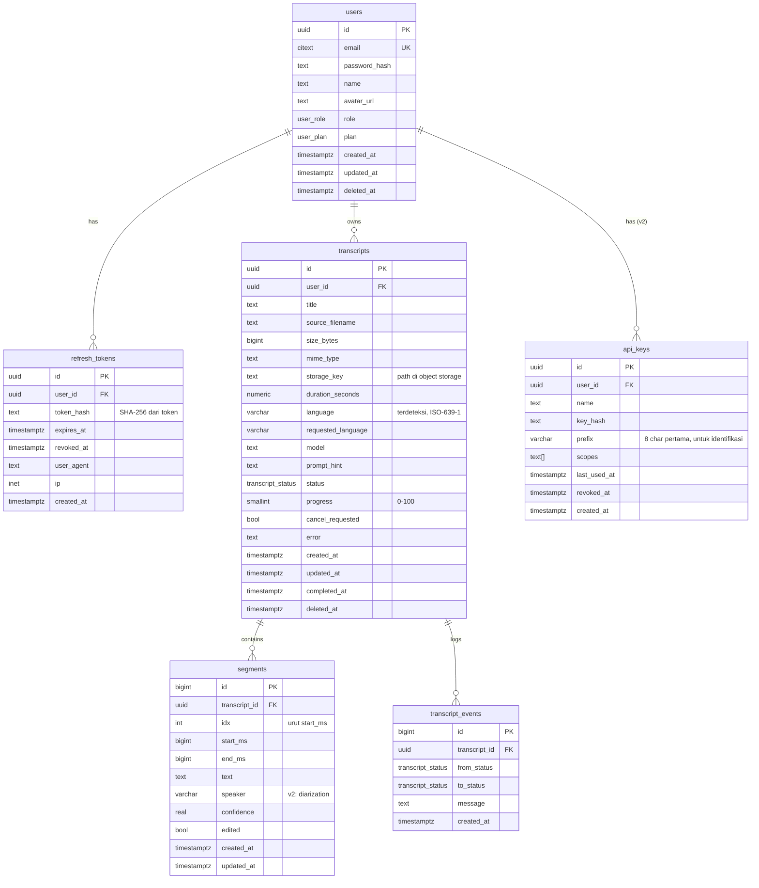

# 04 — Database Design

PostgreSQL 16. Migrasi via **SQLx migrate** (`apps/api/migrations/`), forward-only, nama file `NNNN_deskripsi.sql`.

## 1. ERD



## 2. Enum (PostgreSQL ENUM types)

```sql
CREATE TYPE transcript_status AS ENUM (
  'uploaded','queued','validating','chunking','transcribing',
  'processing','completed','failed','cancelled'
);
CREATE TYPE user_role  AS ENUM ('user','admin');
CREATE TYPE user_plan  AS ENUM ('free','pro');
```

## 3. Index

```sql
-- antrean worker: claim job tercepat
CREATE INDEX idx_transcripts_queue ON transcripts (created_at)
  WHERE status = 'queued' AND deleted_at IS NULL;

-- listing dashboard user
CREATE INDEX idx_transcripts_user_created ON transcripts (user_id, created_at DESC)
  WHERE deleted_at IS NULL;

-- segments per transcript (terurut)
CREATE INDEX idx_segments_transcript_idx ON segments (transcript_id, idx);

-- hapus token kedaluwarsa (job maintenance harian)
CREATE INDEX idx_refresh_tokens_expires ON refresh_tokens (expires_at)
  WHERE revoked_at IS NULL;

-- pencarian judul (cukup untuk MVP; upgrade pg_trgm v1.1)
CREATE INDEX idx_transcripts_title_trgm ON transcripts USING gin (title gin_trgm_ops);
```

## 4. Kebijakan Data & Retensi

| Data | Retensi | Mekanisme |
|---|---|---|
| File audio di storage | default 30 hari setelah `completed` | lifecycle rule S3/MinIO + reaper harian sinkron DB |
| Row `transcripts`+`segments` (soft-deleted) | purge hard delete setelah 7 hari | task maintenance |
| `refresh_tokens` | hapus saat expired/revoked >7 hari | task maintenance |
| `transcript_events` | 90 hari (audit debug) | partisi bulanan (opsional) |

## 5. Contoh Query Penting

**Claim job oleh worker (aman multi-worker):**
```sql
UPDATE transcripts SET status='validating', updated_at=now()
WHERE id = (
  SELECT id FROM transcripts
  WHERE status='queued' AND cancel_requested = false AND deleted_at IS NULL
  ORDER BY created_at
  FOR UPDATE SKIP LOCKED LIMIT 1
)
RETURNING id, user_id, storage_key, requested_language, model, prompt_hint;
```

**Simpan hasil chunk ke-n (transaksi):**
```sql
BEGIN;
  UPDATE transcripts SET progress = $2, status='transcribing', updated_at=now() WHERE id=$1;
  INSERT INTO segments (transcript_id, idx, start_ms, end_ms, text, confidence)
  SELECT $1, $3+n, $4+s.start_ms, $4+s.end_ms, s.text, s.conf
  FROM unnest($5::segment_payload[]) AS s;
COMMIT;
```

**Reaper job stale (worker mati di tengah):**
```sql
UPDATE transcripts SET status='queued', progress=0, updated_at=now()
WHERE status IN ('validating','chunking','transcribing','processing')
  AND updated_at < now() - interval '10 minutes'
  AND id NOT IN (SELECT unnest($1::uuid[]));  -- $1 = job yang sedang hidup di worker ini
RETURNING id;
```

## 6. Migrasi & Seeding

- `0001_init.sql` — users, refresh_tokens, transcripts, segments, transcript_events, enums, index.
- `0002_retention.sql` — kebijakan & task pendukung (function `purge_soft_deleted()`).
- Seed dev: `cargo sqlx migrate run` + `cargo run -- seed` (2 user demo, 3 transcript contoh).
- SQLite untuk dev cepat **tidak dipakai** demi konsistensi (enum/citext/SKIP LOCKED) — dev pakai Postgres via docker-compose; trade-off dijelaskan di [ADR-004](adr/004-postgres-sqlx.md).

## 7. Backup & Recovery

- Managed PG (RDS/Neon/Fly Postgres) dengan PITR harian.
- DB bisa dibangun ulang dari *event log* minimal `transcript_events` + audio di storage (RPO 24 jam untuk MVP — cukup, karena audio adalah sumber utama dan ada di S3 dengan replikasi).
