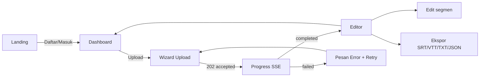

# 07 — UI/UX Design

> **Pembaruan (Nov 2026):** UI direfactor dengan art direction "achromatic ledger"
> (taste-skill, seed 827662554) — token di `apps/web/src/app.css` adalah sumber
> kebenaran; snippet §2 di bawah adalah versi historis fase 0. Ringkas: ground
> blue-grey `#f2f4f7`, chrome tinta tanpa warna merek, SATU hue data `#1d5fbf`
> hanya untuk progres live + segment aktif, semua angka Geist Mono (ledger),
> primer near-black `#141414`, radius 8/6/4, pill status pucat se-hue.

## 1. Prinsip Desain

1. **Tenang dan fokus** — produk alat kerja: netral gelap/terang, satu warna aksen.
2. **Status selalu terlihat** — progres transkripsi tidak boleh terasa "menggantung".
3. **Editor-first** — transcript adalah panggung utama, chrome UI minimal.
4. **Cepat terasa** — skeleton > spinner; optimistic update untuk edit teks.

## 2. Design Tokens

```css
/* app.css (ringkas) */
:root {
  /* palette — accent: teal */
  --bg: #fafafa; --surface: #ffffff; --surface-2: #f4f4f5;
  --text: #18181b; --text-muted: #71717a;
  --border: #e4e4e7;
  --accent: #0d9488; --accent-hover: #0f766e; --accent-soft: #ccfbf1;
  --success: #16a34a; --warning: #d97706; --danger: #dc2626;

  /* typography */
  --font-sans: "Inter", system-ui, sans-serif;
  --font-mono: "JetBrains Mono", ui-monospace, monospace; /* timestamp */
  --text-xs: 0.75rem; --text-sm: 0.875rem; --text-base: 0.9375rem; --text-lg: 1.125rem;

  /* radius & shadow */
  --radius: 10px; --radius-sm: 6px;
  --shadow-sm: 0 1px 2px rgb(0 0 0 / 0.05);
}
.dark { --bg:#0c0c0e; --surface:#16161a; --surface-2:#1f1f24; --text:#f4f4f5;
  --text-muted:#a1a1aa; --border:#27272a; --accent:#14b8a6; --accent-soft:#042f2e; }
```

Warna status: `queued/validating` → muted; `chunking/transcribing/processing` → accent; `completed` → success; `failed` → danger; `cancelled` → warning.

## 3. Wireframes

### 3.1 Dashboard (`/dashboard`)

```
┌──────────────────────────────────────────────────────────────┐
│ ◆ TranscribeAI        [🔍 search transcripts]   [Upload ▸] [👤] │
├──────────────────────────────────────────────────────────────┤
│                                                                │
│  Riwayat Transkripsi                        [Semua ▾] [Terbaru▾]│
│  ┌──────────────────────────────────────────────────────────┐ │
│  │ 🎙 Kuliah AI #3 — LLM          [✓ Selesai]  id · 12m 04s │ │
│  │    31 Okt 09:12 · whisper-large-v3-turbo        [⋯]      │ │
│  ├──────────────────────────────────────────────────────────┤ │
│  │ 🎙 Interview CEO — bagian 2   [◐ Transkripsi 62%] ▓▓▓▓░░ │ │
│  │    31 Okt 10:03   chunk 3/5                              │ │
│  ├──────────────────────────────────────────────────────────┤ │
│  │ 🎙 Meeting sprint-44           [✕ Gagal]  [↻ Coba lagi]  │ │
│  └──────────────────────────────────────────────────────────┘ │
│   ← 1 2 3 →                                                    │
└──────────────────────────────────────────────────────────────┘
```

### 3.2 Upload (`/upload`)

```
┌──────────────────────────────────────────────────────────────┐
│ ← Kembali                                                     │
│  Transkripsi Baru                                             │
│  ┌────────────────────────────────────────────────────────┐  │
│  │            ⬇  Tarik & lepas file audio di sini          │  │
│  │        atau  [ Pilih File ]  (mp3, wav, m4a, … ≤200MB)  │  │
│  └────────────────────────────────────────────────────────┘  │
│  ┌ dipilih ────────────────────────────────────────────────┐  │
│  │ 🎵 kuliah-ai-3.m4a  · 14.5 MB · ~12 mnt      [ganti] ✕  │  │
│  │ Judul        [ Kuliah AI #3 — LLM                    ]  │  │
│  │ Bahasa       [ Deteksi otomatis ▾ ]                     │  │
│  │ Model        [ whisper-large-v3-turbo (cepat) ▾ ]        │  │
│  │ Petunjuk AI  [ Nama dosen: Dr. Rani. Istilah: RAG,.. ]  │  │
│  │                            (opsional, ≤500 karakter)     │  │
│  │                              [ Batal ]  [ ▶ Transkripsi ]│  │
│  └────────────────────────────────────────────────────────┘  │
└──────────────────────────────────────────────────────────────┘
```

Progress state (setelah submit):
```
│  Mengunggah…  ▓▓▓▓▓▓▓▓▓▓░░░░ 68%      (byte-level)            │
│  → Mentranskripsi  ▓▓▓▓▓░░░░░ 42%   chunk 2/5  (~50 dtk lagi)│
```

### 3.3 Detail + Editor (`/t/[id]`)

```
┌──────────────────────────────────────────────────────────────┐
│ ← Riwayat │ Kuliah AI #3 — LLM ✎        [Ekspor ▾] [⋯]        │
├───────────────────────────┬──────────────────────────────────┤
│ ▶ 04:12 ━━━━━━━━━●━━━━━━ │ 00:00:00  Selamat pagi Bapak/Ibu,  │
│ ── waveform ringkas ──   │           hari ini kita bahas LLM.│
│ [1x ▾] [⏮ segmen] [⏭]   │ 00:00:04  Perkenalkan topik RAG…   │
│ 🌐 id (98%) · 12m 04s    │ 00:00:09  [editor: klik untuk edit]│
│ ⚡ turbo · 31 Okt 09:12   │    …                             │
│                          │  (segment aktif = highlight mint) │
├───────────────────────────┴──────────────────────────────────┤
│ Ekspor: [TXT] [SRT] [VTT] [JSON]      Total 128 segmen · 3 diedit│
└──────────────────────────────────────────────────────────────┘
```

Interaksi kunci:
- Klik timestamp → player seek.
- Player berjalan → segment aktif auto-highlight + auto-scroll (bisa di-pause).
- Klik teks → edit inline; `⏎` simpan (PATCH optimistic), `Esc` batal; label "diedit" abu kecil.
- `Ekspor ▾` → menu format; nama file = slug judul.

### 3.4 Auth (`/login`, `/register`)
Kartu tengah, logo, form minimal, link silang, pesan error inline di bawah field. Tidak ada alert blocking.

## 4. User Flow Utama



## 5. State & Empty States

| Kondisi | Tampilan |
|---|---|
| Dashboard kosong | Ilustrasi + "Belum ada transkripsi. Unggah audio pertamamu →" |
| List loading | 4 skeleton row |
| Job aktif | Progress bar + persen + pesan fase (chunk i/n) |
| Job gagal | Badge merah + alasan singkat + tombol Coba lagi |
| Transkripsi pending dibuka | Placeholder editor: "Transkripsi sedang diproses — halaman ini otomatis diperbarui" |
| Koneksi SSE putus | Toast kecil "Koneksi lambat…" → auto reconnect → fallback polling |
| 404/403 | Halaman ramah: "Transkripsi tidak ditemukan" |

## 6. Aksesibilitas & Bahasa

- Kontras AA; fokus keyboard terlihat; dropzone punya tombol keyboard-equivalent.
- `aria-live="polite"` untuk status job; `aria-current` untuk segment aktif.
- Label form eksplisit; error terkait field (bukan hanya alert global).
- UI copy Bahasa Indonesia (default), struktur siap i18n (svelte i18n) — v2 EN.
- Ukuran sentuh ≥ 44px pada tombol utama (mobile).

## 7. Responsif

| Breakpoint | Layout |
|---|---|
| ≥1024px | Dashboard penuh; editor dua kolom (player kiri) |
| 640–1023px | Satu kolom; player sticky top |
| <640px | Navigation bottom-tab ringkas (Riwayat / Upload / Pengaturan) |

## 8. Toast & Feedback

Semua aksi non-trivial (upload, retry, export, edit tersimpan, logout) → toast 3 detik di kanan-bawah, auto-dismiss, `role="status"`.
Aksi destruktif (hapus) → dialog konfirmasi dengan nama item.
